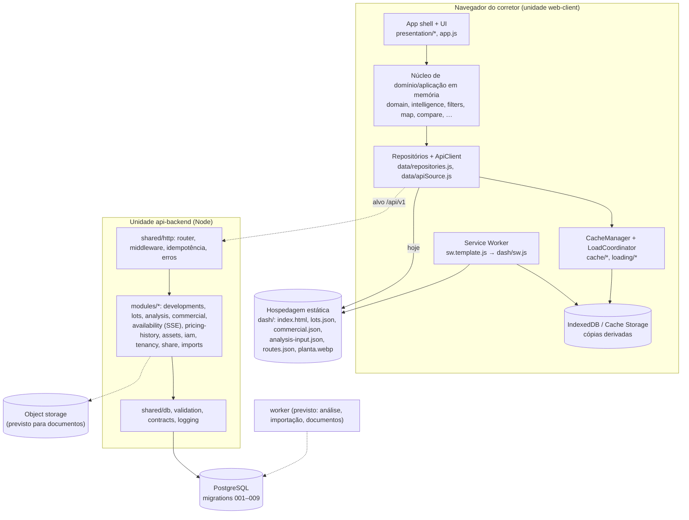

# Arquitetura de containers (C4 nível 2)

| Container | Tecnologia | Responsabilidade | Não é responsável por | Estado |
|---|---|---|---|---|
| web-client | HTML/CSS/JS sem framework, build de página única (`scripts/build.js`) | mapa, interação, cálculos locais (filtro, camada, Fit, comparação, simulação), projeções por modo | autorização final, verdade de disponibilidade/preço | em produção estática |
| Service Worker | `sw.template.js` + regras geradas por `scripts/cacheRules.js` | rede e cache, offline | score, disponibilidade, regra de venda | em uso; tópico 49 em andamento |
| IndexedDB/Cache Storage | navegador | cópias derivadas versionadas | fonte de verdade, dados de cliente (só memória) | em uso |
| Hospedagem estática | arquivos em `dash/` | publicar o build e os dados versionados | — | em uso |
| api-backend | Node + `pg` | autoridade de dados mutáveis, versões publicadas, auditoria, idempotência | renderização | código pronto; testes de banco não rodam aqui |
| PostgreSQL | 25 tabelas (developments … auth_tokens) | persistência transacional | binários grandes | migrations versionadas |
| Object storage | a decidir | arquivos de documentos | ACL (decidida no app) | não implementado (D-DOCS-STORAGE) |
| worker | mesmo código do backend | jobs assíncronos | requisições simples | não implementado |

Mesma base de código para api-backend e worker (tópico 52 §368). Pacote compartilhado: `documents/integrity.js` e o motor de análise já rodam no browser, no harness Node e no backend (`analysis/preview`), sem cópia de fórmula.
