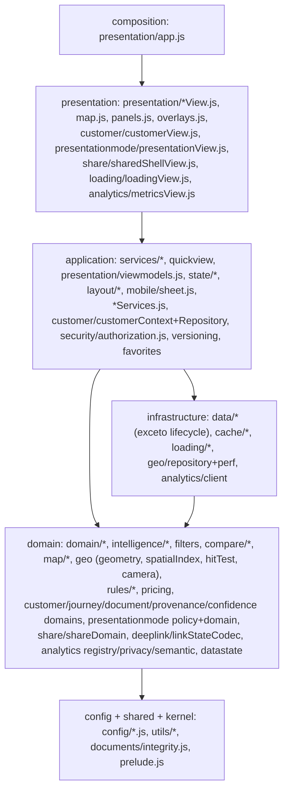

# Arquitetura do frontend

## 1. Forma física

- Um único `index.html` gerado por `node scripts/build.js` em `dash/`: concatena os módulos na ordem de `tests/harness.js` (`ORDER`, módulos sem UI) e depois a lista `UI` do build (views, `presentation/map.js`, `panels.js`, `overlays.js`, `app.js`). As configs de `plat/config/**` entram como um único `App.configs = {…}` (`scripts/configBundle.js`) logo depois de `prelude.js`.
- Sem framework e sem imports: `prelude.js` cria `window.App`; cada arquivo atribui um namespace (`App.compare.domain = (() => {…})()`). O mesmo código roda no browser, no harness Node (`vm`) e, para o motor, no backend.
- O namespace é o contrato do módulo. Um namespace tem um único dono (regra `NAMESPACE_OWNERSHIP`; `App.analytics` tem um dono só, `analytics/facade.js` — GAP-ARCH-10 resolvido em 2026-10-12).

## 2. Camadas (pastas reais → camada)

O mapeamento exato arquivo → contexto → camada está em `config/governance/architecture.json` e em [DOMAIN_MODULE_MAP.md](DOMAIN_MODULE_MAP.md).

## 3. Estado

| Tipo | Onde | Persistência |
|---|---|---|
| Estado de domínio (Lots, versões, disponibilidade) | `data/repositories.js` (LotRepository) | IndexedDB/cache como cópia derivada |
| Estado da aplicação (lote atual, filtros, camada, comparação, objetivo) | `state/store.js` (ApplicationState) + `state/selectors.js` (memoizados) | localStorage para conveniências por aparelho; nunca autorização |
| Estado de layout (painéis, larguras, overlay ativo) | `layout/workspace.js`, `mobile/sheet.js` | localStorage por aparelho |
| Estado de cliente/jornada | `customer/*`, `journey/*` | **somente memória** (política CUSTOMER_PROFILE = MEMORY_ONLY) |
| Estado de carregamento | `loading/coordinator.js` | memória |

Domínio ≠ layout: trocar de painel não invalida filtro, seleção ou comparação (`STATE_CONTINUITY_MATRIX.md`).

## 4. Fluxos de runtime de referência

**Boot do mapa**: app shell → estado salvo → quadro do mapa (config) → `LoadCoordinator` (planner: required/deferred) → `LotRepository.load()` (cache primeiro, rede depois; checksum por snapshot) → `MapView` desenha polígonos uma vez → camada aplicada por `map/layers.buildRenderModel` → legenda (`map/legend.js`) → carga de fundo (analysis-input, rotas).

**Seleção de lote**: toque → `geo/hitTest` (índice espacial) → `store.select(lotId)` → `quickview.build` (ViewModel único) → painel/sheet. Nenhum recálculo de score.

**Recomendação**: perfil (Fit) → constraints (nunca relaxadas) → elegibilidade por disponibilidade (UNKNOWN nunca é elegível) → ranking → explicação por reason codes → mapa recebe ids prontos.

**Comparação**: ids de lote na sessão (`compare/comparisonDomain`) → valores do Lote canônico via `resolve` → snapshot → avaliação por critério (`criterionWinner`) → `compareView`.

**Compartilhar**: `shareVM` (status honesto + rodapé de incerteza) → `services/share` (texto + wa.me) ou `share/*` (ShareDefinition/Grant, client-safe).

## 5. Regras do frontend

UI não lê JSON bruto (repositórios), não chama `fetch` (só `data/apiSource.js`, `data/repositories.js`, `loading` via app), não executa regra crítica como autoridade, não altera o Lote. Domínio não toca DOM, storage, rede. Verificado em `tests/architecture52.test.js`.

## 6. Lacunas conhecidas

`presentation/app.js` nomeia `analysis-input.json` (GAP-ARCH-11); `layout/responsiveProfile.js` mede o DOM dentro do resolver (GAP-ARCH-09); domínios chamando `App.authz` diretamente (GAP-ARCH-01). Detalhes e fase de correção: [ARCHITECTURE_GAP_REPORT.md](ARCHITECTURE_GAP_REPORT.md).
