# Grafo de dependências do roadmap

> Documento gerado por `node scripts/governanceDocs.js` a partir de `config/governance/roadmap.json`. Não editar à mão: altere a fonte e gere de novo.

Setas cheias = dependência HARD; tracejadas = VALIDATION (pode implementar, não pode cortar antes da outra validar). Dependências SOFT/OPTIONAL ficam só nos dados. Cores: verde DONE, azul VALIDATING, amarelo IN_PROGRESS, vermelho BLOCKED, cinza READY, branco NOT_STARTED.

```mermaid
flowchart TD
  subgraph W0["W0 · Baseline e segurança da migração"]
    P0_1["0.1 Architecture Inventory"]:::done
    P0_2["0.2 Architecture Gap Report"]:::done
    P0_3["0.3 Capability Preservation Baseline"]:::done
    P0_4["0.4 Golden Dataset"]:::done
    P0_5["0.5 Regression Harness"]:::val
  end
  subgraph W1["W1 · Fundação de domínio e dados"]
    P1_1["1.1 Data Catalog / Field Registry"]:::done
    P1_2["1.2 Canonical Lot"]:::done
    P1_3["1.3 Data State Semantics"]:::done
    P1_4["1.4 Static / Versioned / Dynamic split"]:::done
    P1_5["1.5 Repository Boundary"]:::val
    P1_6["1.6 Provenance Foundation"]:::done
    P1_7["1.7 Analysis Versioning Foundation"]:::done
  end
  subgraph W2["W2 · Mapa e experiência principal"]
    P2_1["2.1 Map Workspace"]:::done
    P2_2["2.2 Map Layer Architecture"]:::done
    P2_3["2.3 Smart Legend"]:::done
    P2_4["2.4 LotQuickView"]:::done
    P2_5["2.5 Mobile Bottom Sheet"]:::done
    P2_6["2.6 Desktop Workstation"]:::done
    P2_7["2.7 Tablet Adaptive Profile"]:::done
    P2_8["2.8 Filter System"]:::done
    P2_9["2.9 Menu Compacto"]:::prog
    P2_10["2.10 Geometry Performance"]:::done
    P2_11["2.11 Location Intelligence (Entorno)"]:::prog
  end
  subgraph W3["W3 · Backend/API e autoridade dinâmica"]
    P3_1["3.1 Backend Skeleton"]:::val
    P3_2["3.2 API v1"]:::val
    P3_3["3.3 Authentication"]:::val
    P3_4["3.4 Organization/Tenant Context"]:::prog
    P3_5["3.5 Availability backend authority"]:::blk
    P3_6["3.6 Pricing backend/versioning"]:::prog
    P3_7["3.7 Financial Service"]:::ready
    P3_8["3.8 Documents foundation"]:::prog
    P3_9["3.9 Deals: proposta, reserva e fechamento"]:::prog
  end
  subgraph W4["W4 · Inteligência explicável"]
    P4_1["4.1 Intelligence Engine"]:::done
    P4_2["4.2 Configurable Scoring"]:::done
    P4_3["4.3 Customer Fit"]:::done
    P4_4["4.4 Recommendation Engine"]:::done
    P4_5["4.5 Explainable Rankings"]:::done
    P4_6["4.6 Confidence Score"]:::val
    P4_7["4.7 Rule Engine"]:::val
    P4_8["4.8 Comparison Domain"]:::done
    P4_9["4.9 Winner per Criterion"]:::done
    P4_10["4.10 Price History"]:::val
  end
  subgraph W5["W5 · Cliente e jornada"]
    P5_1["5.1 Favorites Formal Domain"]:::done
    P5_2["5.2 Customer Domain"]:::prog
    P5_3["5.3 Customer Preference Profile"]:::val
    P5_4["5.4 Customer Context in UI"]:::done
    P5_5["5.5 Journey"]:::prog
    P5_6["5.6 Recommendation + Customer"]:::prog
    P5_7["5.7 Comparison + Customer"]:::prog
    P5_8["5.8 CRM adapters"]:::blk
  end
  subgraph W6["W6 · Apresentação, Share e colaboração"]
    P6_1["6.1 Presentation Mode"]:::done
    P6_2["6.2 Client-Safe Projection"]:::val
    P6_3["6.3 ShareService"]:::prog
    P6_4["6.4 Deep Links"]:::done
    P6_5["6.5 WhatsApp Payload"]:::val
    P6_6["6.6 Presentation Journey Integration"]:::prog
    P6_7["6.7 Export foundation"]:::ns
  end
  subgraph W7["W7 · PWA, segurança e observabilidade"]
    P7_1["7.1 Cache Architecture"]:::done
    P7_2["7.2 Lazy Loading"]:::done
    P7_3["7.3 PWA"]:::prog
    P7_4["7.4 Offline Pack"]:::prog
    P7_5["7.5 Security hardening"]:::prog
    P7_6["7.6 Observability"]:::prog
    P7_7["7.7 Operational Runbooks"]:::ns
    P7_8["7.8 Privacy / LGPD"]:::prog
  end
  subgraph W8["W8 · Multi-tenant e expansão"]
    P8_1["8.1 Organization Management"]:::ns
    P8_2["8.2 Multi-Development"]:::ready
    P8_3["8.3 Development Config"]:::prog
    P8_4["8.4 Organization Branding"]:::ns
    P8_5["8.5 Entitlements"]:::ns
    P8_6["8.6 Cross-Tenant Security Tests"]:::prog
    P8_7["8.7 New Development Import Pipeline"]:::prog
    P8_8["8.8 Admin / Operations Shell"]:::prog
    P8_9["8.9 Data Quality Governance"]:::prog
  end
  subgraph W9["W9 · Otimização e retirada do legado"]
    P9_1["9.1 Legacy Usage Review"]:::ns
    P9_2["9.2 Remove Migration Flags"]:::ns
    P9_3["9.3 Remove Legacy Adapters"]:::ns
    P9_4["9.4 Remove Old JSON Direct Access"]:::ns
    P9_5["9.5 Remove Duplicate Formula Paths"]:::ns
    P9_6["9.6 Remove Legacy Menu/Routes"]:::ns
    P9_7["9.7 Performance Optimization"]:::ns
    P9_8["9.8 Database/Index Optimization"]:::ns
    P9_9["9.9 Cost Optimization"]:::ns
    P9_10["9.10 Architecture Review"]:::ns
  end
  P0_1 --> P0_2
  P0_1 --> P0_3
  P0_3 --> P0_4
  P0_4 --> P0_5
  P0_5 -.-> P1_1
  P1_1 --> P1_2
  P1_2 --> P1_3
  P1_2 --> P1_4
  P1_2 --> P1_5
  P1_1 --> P1_6
  P1_4 --> P1_7
  P1_2 --> P2_2
  P2_2 --> P2_3
  P1_2 --> P2_4
  P2_4 --> P2_5
  P2_1 --> P2_6
  P2_1 --> P2_7
  P1_3 --> P2_8
  P2_1 --> P2_9
  P0_4 -.-> P2_10
  P3_1 --> P3_2
  P3_2 --> P3_3
  P3_3 --> P3_4
  P3_4 --> P3_5
  P3_4 --> P3_6
  P3_6 --> P3_7
  P3_4 --> P3_8
  P1_7 --> P4_1
  P4_1 --> P4_2
  P1_2 --> P4_3
  P4_3 --> P4_4
  P4_4 --> P4_5
  P1_6 --> P4_6
  P4_1 --> P4_7
  P1_2 --> P4_8
  P4_8 --> P4_9
  P1_2 --> P5_1
  P3_4 -.-> P5_2
  P4_3 --> P5_3
  P5_2 --> P5_5
  P4_4 --> P5_6
  P5_3 --> P5_6
  P4_8 --> P5_7
  P5_5 --> P5_8
  P6_1 --> P6_2
  P6_2 --> P6_3
  P3_3 -.-> P6_3
  P2_8 --> P6_4
  P6_3 --> P6_5
  P5_5 --> P6_6
  P6_2 --> P6_7
  P1_4 --> P7_1
  P7_1 --> P7_3
  P7_3 --> P7_4
  P7_5 -.-> P7_4
  P7_6 --> P7_7
  P3_4 --> P8_1
  P3_4 --> P8_2
  P8_1 --> P8_4
  P8_1 --> P8_5
  P3_4 --> P8_6
  P8_3 --> P8_7
  P0_5 --> P9_1
  P3_2 --> P9_1
  P9_1 --> P9_4
  P9_1 --> P9_7
  P9_1 --> P9_2
  P9_1 --> P9_3
  P1_5 --> P9_4
  P9_1 --> P9_5
  P2_9 --> P9_6
  P2_10 --> P9_7
  P3_1 --> P9_8
  P9_2 --> P9_10
  P9_3 --> P9_10
  P9_4 --> P9_10
  P9_5 --> P9_10
  P3_3 --> P8_8
  P3_3 --> P3_9
  classDef done fill:#dff0d8,stroke:#3c763d
  classDef val fill:#e8f4fb,stroke:#31708f
  classDef prog fill:#fcf8e3,stroke:#8a6d3b
  classDef blk fill:#f2dede,stroke:#a94442
  classDef ready fill:#f5f5f5,stroke:#777
  classDef ns fill:#ffffff,stroke:#bbb
```

## Situação por onda

| Onda | Nome | Fases | DONE | VALIDATING | IN_PROGRESS | BLOCKED | READY | NOT_STARTED |
|---|---|---|---|---|---|---|---|---|
| W0 | Baseline e segurança da migração | 5 | 4 | 1 | 0 | 0 | 0 | 0 |
| W1 | Fundação de domínio e dados | 7 | 6 | 1 | 0 | 0 | 0 | 0 |
| W2 | Mapa e experiência principal | 11 | 9 | 0 | 2 | 0 | 0 | 0 |
| W3 | Backend/API e autoridade dinâmica | 9 | 0 | 3 | 4 | 1 | 1 | 0 |
| W4 | Inteligência explicável | 10 | 7 | 3 | 0 | 0 | 0 | 0 |
| W5 | Cliente e jornada | 8 | 2 | 1 | 4 | 1 | 0 | 0 |
| W6 | Apresentação, Share e colaboração | 7 | 2 | 2 | 2 | 0 | 0 | 1 |
| W7 | PWA, segurança e observabilidade | 8 | 2 | 0 | 5 | 0 | 0 | 1 |
| W8 | Multi-tenant e expansão | 9 | 0 | 0 | 5 | 0 | 1 | 3 |
| W9 | Otimização e retirada do legado | 10 | 0 | 0 | 0 | 0 | 0 | 10 |

Maturidade atual (tópico 55 §317): **L1 — Canonical data**. L0 5/5 · L1 7/7 · L2 9/11 · L3 3/9 · L4 10/10 · L5 3/8 · L6 6/15 · L7 0/9.

Próximas fases acionáveis (dependências HARD DONE/VALIDATING): 2.9, 3.4, 5.2, 5.6, 5.7, 6.3, 6.7, 7.3, 7.5, 7.6, 8.3, 9.1, 9.8, 9.9, 2.11, 3.9, 7.8, 8.8, 8.9.

Ordem topológica: 0.1 → 0.2 → 0.3 → 0.4 → 0.5 → 1.1 → 1.2 → 1.3 → 1.4 → 1.5 → 1.6 → 1.7 → 2.1 → 2.2 → 2.3 → 2.4 → 2.5 → 2.6 → 2.7 → 2.8 → 2.9 → 2.10 → 2.11 → 3.1 → 3.2 → 3.3 → 3.4 → 3.5 → 3.6 → 3.7 → 3.8 → 3.9 → 4.1 → 4.2 → 4.3 → 4.4 → 4.5 → 4.6 → 4.7 → 4.8 → 4.9 → 4.10 → 5.1 → 5.2 → 5.3 → 5.4 → 5.5 → 5.6 → 5.7 → 5.8 → 6.1 → 6.2 → 6.3 → 6.4 → 6.5 → 6.6 → 6.7 → 7.1 → 7.2 → 7.3 → 7.5 → 7.4 → 7.6 → 7.7 → 7.8 → 8.1 → 8.2 → 8.3 → 8.4 → 8.5 → 8.6 → 8.7 → 8.8 → 8.9 → 9.1 → 9.2 → 9.3 → 9.4 → 9.5 → 9.6 → 9.7 → 9.8 → 9.9 → 9.10.

## Todas as dependências

| De | Para | Tipo | Motivo |
|---|---|---|---|
| 0.1 | 0.2 | HARD | gap report compara o inventário |
| 0.1 | 0.3 | HARD | capacidades vêm do inventário |
| 0.3 | 0.4 | HARD | golden cobre as capacidades |
| 0.4 | 0.5 | HARD | harness compara com o golden |
| 0.5 | 1.1 | VALIDATION | fundação de dados só corta com regressão verde |
| 1.1 | 1.2 | HARD | Lot canônico usa o Field Registry |
| 1.2 | 1.3 | HARD |  |
| 1.2 | 1.4 | HARD |  |
| 1.2 | 1.5 | HARD | repositório devolve Lot canônico |
| 1.1 | 1.6 | HARD | proveniência por campo do registro |
| 1.4 | 1.7 | HARD | versão analítica separada |
| 1.5 | 2.1 | SOFT | mapa pode evoluir antes do repositório completo |
| 1.2 | 2.2 | HARD |  |
| 2.2 | 2.3 | HARD | legenda deriva do modelo de render |
| 1.2 | 2.4 | HARD |  |
| 2.4 | 2.5 | HARD | sheet contém o QuickView |
| 2.1 | 2.6 | HARD |  |
| 2.1 | 2.7 | HARD |  |
| 1.3 | 2.8 | HARD | filtros respeitam data state |
| 2.1 | 2.9 | HARD |  |
| 2.2 | 2.10 | SOFT | otimizar renderer só com baseline |
| 0.4 | 2.10 | VALIDATION | paridade de geometria |
| 1.5 | 3.1 | SOFT |  |
| 3.1 | 3.2 | HARD |  |
| 3.2 | 3.3 | HARD | security boundary antes de writes |
| 3.3 | 3.4 | HARD |  |
| 3.4 | 3.5 | HARD | disponibilidade é tenant-owned |
| 3.4 | 3.6 | HARD |  |
| 3.6 | 3.7 | HARD | financeiro consome PriceTableVersion |
| 3.4 | 3.8 | HARD |  |
| 1.7 | 4.1 | HARD |  |
| 4.1 | 4.2 | HARD |  |
| 1.2 | 4.3 | HARD |  |
| 4.3 | 4.4 | HARD |  |
| 4.4 | 4.5 | HARD |  |
| 1.6 | 4.6 | HARD | confiança usa proveniência |
| 4.1 | 4.7 | HARD |  |
| 1.2 | 4.8 | HARD |  |
| 4.8 | 4.9 | HARD |  |
| 3.6 | 4.10 | SOFT | paralela após versionamento da tabela |
| 1.2 | 5.1 | HARD |  |
| 3.4 | 5.2 | VALIDATION | Customer antes de tenant é anti-padrão: persistência só com tenant |
| 4.3 | 5.3 | HARD |  |
| 5.2 | 5.4 | SOFT | contexto pode usar perfil temporário |
| 5.2 | 5.5 | HARD |  |
| 4.4 | 5.6 | HARD |  |
| 5.3 | 5.6 | HARD |  |
| 4.8 | 5.7 | HARD |  |
| 5.5 | 5.8 | HARD |  |
| 4.9 | 6.1 | SOFT |  |
| 6.1 | 6.2 | HARD |  |
| 6.2 | 6.3 | HARD | share antes de client-safe é anti-padrão |
| 3.3 | 6.3 | VALIDATION | share público exige authz real |
| 2.8 | 6.4 | HARD |  |
| 6.3 | 6.5 | HARD |  |
| 5.5 | 6.6 | HARD |  |
| 6.2 | 6.7 | HARD |  |
| 1.4 | 7.1 | HARD |  |
| 7.1 | 7.2 | SOFT |  |
| 7.1 | 7.3 | HARD |  |
| 7.3 | 7.4 | HARD | offline pack depois de cache/versão |
| 7.5 | 7.4 | VALIDATION | offline pack depois de segurança |
| 3.3 | 7.5 | SOFT |  |
| 3.1 | 7.6 | SOFT |  |
| 7.6 | 7.7 | HARD |  |
| 3.4 | 8.1 | HARD |  |
| 3.4 | 8.2 | HARD | multi-tenant rollout depende de tenant |
| 8.2 | 8.3 | SOFT |  |
| 8.1 | 8.4 | HARD |  |
| 8.1 | 8.5 | HARD |  |
| 3.4 | 8.6 | HARD |  |
| 8.3 | 8.7 | HARD |  |
| 0.5 | 9.1 | HARD |  |
| 3.2 | 9.1 | HARD | uso legado só é medido com o caminho novo em produção |
| 9.1 | 9.4 | HARD |  |
| 9.1 | 9.7 | HARD |  |
| 9.1 | 9.8 | SOFT |  |
| 9.1 | 9.2 | HARD |  |
| 9.1 | 9.3 | HARD |  |
| 1.5 | 9.4 | HARD | remover acesso direto só com repositório validado |
| 9.1 | 9.5 | HARD |  |
| 2.9 | 9.6 | HARD |  |
| 2.10 | 9.7 | HARD |  |
| 3.1 | 9.8 | HARD |  |
| 9.1 | 9.9 | SOFT |  |
| 9.2 | 9.10 | HARD |  |
| 9.3 | 9.10 | HARD |  |
| 9.4 | 9.10 | HARD |  |
| 9.5 | 9.10 | HARD |  |
| 3.3 | 8.8 | HARD | o console administrativo só abre com sessão confirmada pelo servidor |
| 3.3 | 3.9 | HARD | propostas/reservas exigem identidade e autorização no servidor |
| 8.8 | 8.9 | SOFT | filas de qualidade de dados aparecem no console |
