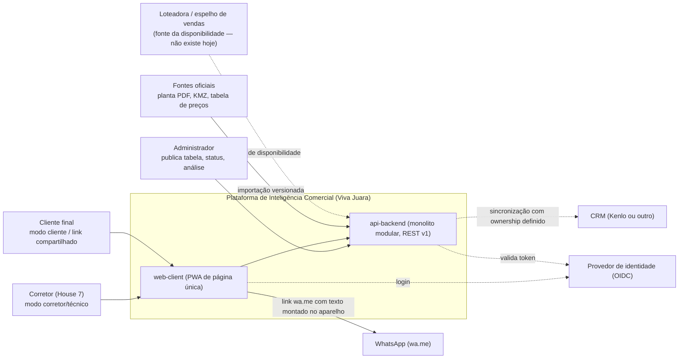

# Diagrama de contexto do sistema (C4 nível 1)

Quem usa a plataforma e com quais sistemas ela conversa. Setas indicam quem inicia. Linhas tracejadas = previsto, ainda não ligado.

| Fronteira | Hoje | Alvo | Pendência |
|---|---|---|---|
| Corretor ↔ web-client | painel estático, sem login; permissões locais deny by default | login real; `/me` como fonte do AccessControlViewModel | D-IDP |
| Cliente ↔ web-client | modo cliente e apresentação no aparelho do corretor; share local | ShareGrant com token no servidor | tópico 42 (contratos) |
| web ↔ api | o painel lê `dash/*.json`; `data/apiSource.js` pronto para `/api/v1` | leitura pela API com shadow read | fase 3.2 |
| Loteadora → api | inexistente: 498 lotes `UNKNOWN` | feed com revisão e frescor | D-SALES-MIRROR, D-AVAIL-FRESHNESS |
| api → CRM | inexistente | adaptador com ownership por campo | D-CRM-OWNERSHIP |
| web → WhatsApp | texto montado no aparelho (`shareVM`) | ShareChannel template | D-WHATSAPP-TEXT |
| Terceiros de analytics (GA/Meta) | nenhum envio; tudo local | só com base legal | D-ANALYTICS-LEGAL |
